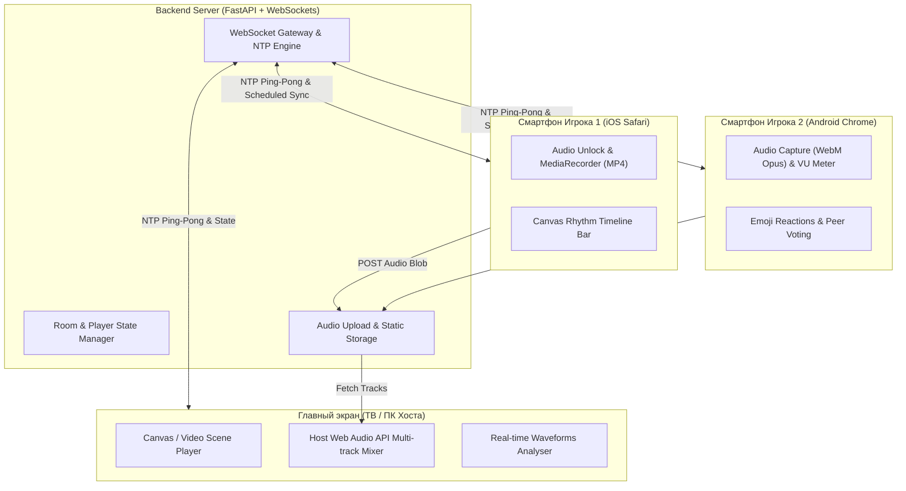

# 🎭 Dumb Together — Браузерная кооперативная пати-игра

<p align="center">
  
  
  
  
  
  
</p>

---

## 📖 Об игре

**«Dumb Together»** — это браузерная кооперативная пати-игра (в духе *Gartic Phone*, *Jackbox.tv* и *Skribbl.io*), в которой игроки озвучивают короткие нелепые видеоклипы и звуковые эффекты через микрофоны своих смартфонов, после чего синхронно смотрят получившийся шедевр в «Кинозале» на общем экране!

Игра работает **полностью в браузере без установки приложений**, поддерживает смартфоны (iOS Safari, Android Chrome) и ПК.

---

## 🌟 Ключевые возможности

* 📺 **Два режима отображения:**
  * **«Общий экран + Смартфоны» (модель Jackbox):** ТВ или ПК выступает в роли хоста (видео, общий таймлайн, сводный звук, таблица очков), а смартфоны игроков работают как беспроводные микрофоны и пульты с подсказками.
  * **«Все в одном» (модель Gartic Phone / Discord):** Игра прямо в окне браузера на ПК.
* ⚡ **Сетевая синхронизация $\le 30\text{ мс}$ (NTP over WebSockets):**
  * Встроенная калибровка часов по алгоритму Кристиана (Cristian's Algorithm) с отсевом сетевого джиттера.
  * Запись стартует не по команде «пиши сейчас», а по запланированному серверному таймстепу (`startAtServerTimestamp = now + 3000ms`), исключая сетевой лаг.
* 🎙️ **Продвинутый аудио-пайплайн:**
  * Автоматическое снятие **WebKit Audio Lock** и ограничений Autoplay в **iOS Safari**.
  * Кроссплатформенная поддержка кодеков: `audio/webm;codecs=opus` (Chrome/Android) и `audio/mp4;codecs=mp4a` (Safari/iOS).
  * Встроенный живой **VU-метр** для проверки микрофона перед началом раунда.
  * Подавление эха (`echoCancellation`), шума (`noiseSuppression`) и авто-усиление (`autoGainControl`).
* 🎧 **Многоканальный Web Audio API микшер на хосте:**
  * Декодирование дорожек через `audioCtx.decodeAudioData` и синхронный запуск `AudioBufferSourceNode`.
  * Индивидуальные живые неоновые **осциллограммы (Waveforms)** над аватарами игроков во время показа.
* 🎸 **Ритм-полоса суфлера (Rhythm Timeline):**
  * Падающие/бегущие блоки реплик и звуков на Canvas с тактильным откликом (`navigator.vibrate`) на смартфонах.
* 💥 **Интерактивные реакции и голосование:**
  * Эмодзи-пушка (🔥, 🤣, 👏, 😱) со смартфонов с полетом эмодзи по экрану Хоста.
  * Голосование зрителей за лучший дубляж и подсчет очков.
* 🎬 **3 готовых встроенных сценария:**
  1. *«Ограбление века: Прокол с сигнализацией»* (Шепот грабителя, мурчание/вопль кота, звон стекла, сирена).
  2. *«Адская кухня безумного шефа»* (Итальянский восторг, шум вентилятора, растяжка теста, смачный шлепок).
  3. *«Драматическое прощание на перроне»* (Пар поезда, свисток кондуктора, крик влюбленного, удар чемодана).

---

## 🏗️ Архитектура системы



---

## 🚀 Быстрый старт (За 1 минуту)

### Требования
* Python 3.10 или новее.

### 1. Клонирование репозитория
```bash
git clone https://github.com/Shantarinmatvey/dumb-together.git
cd dumb-together
```

### 2. Установка зависимостей
```bash
pip install -r requirements.txt
```

### 3. Запуск сервера
```bash
python run.py
```

После запуска в консоли отобразятся ссылки:
* 📺 **Главный экран (Хост):** `http://localhost:8000/static/host.html`
* 📱 **Смартфоны игроков в локальной сети Wi-Fi:** `http://<ваш-локальный-ip>:8000`

---

## 🎮 Как играть с друзьями

1. Откройте **Экран Хоста** на ноутбуке или подключите его к телевизору.
2. На экране появится **4-значный код комнаты** и **QR-код**.
3. Друзья сканируют QR-код камерой смартфона (или переходят по адресу) и вводят свои имена.
4. Каждый игрок нажимает **«Разрешить микрофон»** и проверяет громкость на VU-метре.
5. Хост выбирает клип и нажимает **«Начать раунд»**.
6. Игроки видят свои роли и текст суфлера на экранах смартфонов.
7. После отсчета `3... 2... 1...` все синхронно озвучивают происходящее.
8. Аудиодорожки отправляются в «Кинозал» — наслаждайтесь совместным дубляжем с живыми эквалайзерами!

---

## 📁 Структура проекта

```
dumb-together/
├── app/
│   ├── __init__.py           # Пакет приложения
│   ├── main.py               # FastAPI приложение, CORS, загрузка аудио, статика
│   ├── models.py             # Pydantic модели комнат, ролей, клипов и подсказок
│   ├── room_manager.py       # Логика комнат, распределение ролей, расчет очков
│   └── websocket_handler.py  # WebSocket шлюз: NTP sync, ротация состояний, эвенты
├── static/
│   ├── index.html            # Стартовый экран выбора режима (Хост / Игрок)
│   ├── host.html             # Главный экран («Кинозал», QR-код, таймлайны, миксер)
│   ├── controller.html       # Мобильный пульт (iOS unlock, VU-метр, ритм-бар)
│   ├── css/
│   │   └── style.css         # Неоновый пати-стиль, анимации реакций, glassmorphism
│   └── js/
│       ├── time-sync.js      # NTP-калибровка времени по алгоритму Кристиана
│       ├── audio-engine.js   # Захват аудио, снятие WebKit Lock, MediaRecorder
│       ├── host-mixer.js     # Web Audio API мультитрек-миксер и визуализатор волн
│       ├── rhythm-bar.js     # Canvas ритм-таймлайн со скользящими подсказками
│       └── clips-data.js     # Сценарии и процедурный Canvas-аниматор сцен
├── tests/
│   └── test_room_logic.py    # Автотесты серверной логики комнат
├── uploads/                  # Хранилище записанных аудиодорожек (.gitkeep)
├── run.py                    # Скрипт запуска сервера с автоопределением IP
├── requirements.txt          # Зависимости проекта
├── LICENSE                   # Лицензия MIT
└── README.md                 # Документация проекта
```

---

## 🧪 Запуск тестов

```bash
python -m unittest discover tests
```

---

## 📄 Лицензия

Распространяется под лицензией **MIT**. Подробности в файле [LICENSE](LICENSE).
